<div align="center">

# RAP-WAM

<p><strong>Learning World-Action Models through Predictive Rehearsal<br>and Action Perturbations</strong></p>

[](https://arxiv.org/abs/2610.16443)
[](docs/INSTALLATION.md)
[](LICENSE)

[**Project Page**](https://rapwam.github.io/) · [**Paper**](https://arxiv.org/abs/2610.16443) · [**Method**](#method-overview) · [**Results**](#reported-results) · [**Get Started**](#getting-started) · [**Demos**](#robot-demonstrations) · [**Docs**](#documentation)

</div>

## Method Overview

<p align="center">
  <a href="docs/media/overview.webp">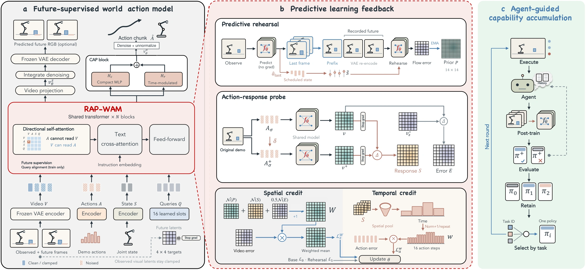</a>
</p>

*RAP-WAM overview from the paper. Panels (a–b) show the base learner implemented here; panel (c) shows the broader post-training system. [Implementation scope](docs/REPRODUCIBILITY.md) · [View full-size figure](docs/media/overview.webp).*

**RAP-WAM** turns the video-pretrained **Wan2.2-TI2V-5B** backbone into a joint policy for robot actions and future observations. It learns from recorded demonstrations through three complementary mechanisms:

- **Future-supervised queries** connect recorded-future visual latents to action generation. Directional attention controls information flow; **Coupled Action Projection (CAP)** combines compact and time-modulated action heads.
- **Predictive rehearsal** uses a generated observation to condition the next demonstration chunk, while retaining recorded actions and futures as targets. Rehearsal errors update a spatial prior.
- **Action-response credit** compares matched original and action-perturbed predictions to allocate spatial visual supervision and temporal action weights. Response measures model sensitivity rather than physical causality.

[Architecture](docs/ARCHITECTURE.md) · [Paper-to-Code Map](docs/PAPER_ALIGNMENT.md) · [Configuration Reference](docs/CONFIGURATION.md)

## Reported Results

The [paper v1](https://arxiv.org/html/2610.16443v1) reports the following results for the research system:

| Evaluation | Base | Base + Task-Specific Refinement |
|---|---:|---:|
| RoboDojo average success rate | 12.85% | 15.62% |
| RoboDojo average score | 17.86 | 20.59 |
| Real robot, 15-task macro-average success | — | 89.00% |

RoboDojo averages 42 task units within five capabilities, then weights the capabilities equally. These paper results include task-specific refinement and retained-policy selection outside this release. Public defaults differ in batch, split, caching and checkpoint selection; they have not been evaluated to reproduce this table. [Evaluation protocol and reproduction differences](docs/REPRODUCIBILITY.md).

## Getting Started

This release provides **RoboDojo training** and **one 28D real-robot training workflow**, including data conversion, context preparation, model/loss code, preflight checks and distributed launch scripts. Pretrained weights and demonstrations are external. Robot control, simulator evaluation, post-training interventions, retained-policy selection and published task checkpoints are outside this release.

### Installation

Use Linux with NVIDIA CUDA for full-model training. Python 3.10 is recommended. From the repository root:

```bash
python3.10 -m venv .venv
source .venv/bin/activate
python -m pip install --upgrade pip
python -m pip install torch==2.8.0 torchvision==0.23.0 \
  --index-url https://download.pytorch.org/whl/cu128
python -m pip install -e '.[data]'
```

This example uses CUDA 12.8 wheels; choose a PyTorch build compatible with your driver. RoboDojo conversion also requires FFmpeg and ffprobe. See the [Installation Guide](docs/INSTALLATION.md) for alternatives, dependency locks and CPU checks.

Download the complete [Wan2.2-TI2V-5B checkpoint](https://huggingface.co/Wan-AI/Wan2.2-TI2V-5B), including transformer configuration/weights and `Wan2.2_VAE.pth`. RoboDojo context preparation also needs its UMT5 encoder and tokenizer. Set the asset location and inspect a configuration without loading the model:

```bash
export WAN_CHECKPOINT_DIR="$PWD/assets/Wan2.2-TI2V-5B"
python -m rap_wam.train --config-name robodojo --cfg job --resolve
```

### Choose a Training Workflow

| | RoboDojo | Real Robot |
|---|---|---|
| Demonstrations | LeRobot v2.1 episode videos + parquet | 100 synchronized, named-array NPZ episodes |
| Vision | Head + two wrists; 384 × 320 T-shaped mosaic | Head camera; 224 × 224 RGB |
| State / action | 14D absolute joint positions | 28D absolute joint positions |
| Language | Precomputed per-task UMT5 embeddings | No language conditioning |
| Default split | 5% episode-level validation | All 100 episodes for training |
| Preparation guide | [RoboDojo Training](docs/ROBODOJO.md) | [Real-Robot Training](docs/REAL_ROBOT.md) |

Prepare and validate your data with the corresponding guide before launching. Both workflows produce sharded Zarr datasets; use a new output directory for each conversion and training run. Full 5B training needs sufficient GPU memory; the public recipes have no measured minimum-VRAM guarantee.

### RoboDojo Training

Follow the [RoboDojo Guide](docs/ROBODOJO.md) to obtain compatible demonstrations, convert the three-camera data, encode the ordered instruction vocabulary and run full preflight validation. Then launch:

```bash
export DATA_ROOT="$PWD/data/robodojo/zarr"
export TASK_CONTEXT_PATH="$PWD/data/robodojo/task_context.pt"
NPROC_PER_NODE=1 bash scripts/train_robodojo.sh --dry-run
NPROC_PER_NODE=1 bash scripts/train_robodojo.sh
```

Keep `task_strings.json` and the context table with each run; the table is not embedded in checkpoints. The default **35 training instructions** are distinct from the benchmark's **42 evaluation task units**.

### Real-Robot Training

Follow the [Real-Robot Guide](docs/REAL_ROBOT.md) and [NPZ Data Contract](docs/DATA_FORMAT.md#real-robot-input) to export, convert and validate exactly 100 synchronized demonstrations. The converter does not perform robot SDK conversion or temporal synchronization. Then launch:

```bash
export DATA_ROOT="$PWD/data/real_robot/zarr"
NPROC_PER_NODE=1 bash scripts/train_real_robot.sh --dry-run
NPROC_PER_NODE=1 bash scripts/train_real_robot.sh
```

This profile uses 28D absolute joint positions and all 100 episodes for training, with an intentionally empty validation set. It does not include the paper's additional 32D interface or the full 15-task evaluation suite.

### Training Configuration

Both profiles default to **full-parameter DiT training**, a frozen observation encoder, BF16, **no LoRA**, batch **2 per GPU** and gradient accumulation **1**. Override resources explicitly:

```bash
export RUN_DIR="$PWD/outputs/robodojo/run_001"
BATCH_SIZE=2 GRAD_ACCUM_STEPS=1 NPROC_PER_NODE=8 \
  bash scripts/train_robodojo.sh optimizer.lr=2e-4
```

Effective global batch = per-GPU batch × GPUs per node × nodes × accumulation. At batch 1, the optional local-batch difficulty correction vanishes; accumulation does not restore it. See [Training Recipes](docs/TRAINING_RECIPES.md) for multi-node setup, [Configuration](docs/CONFIGURATION.md) for schedules/losses and [Checkpoints](docs/CHECKPOINTS.md) for logs, companion files and continuation limits.

## Robot Demonstrations

<p align="center">
  <a href="https://rapwam.github.io/#demos">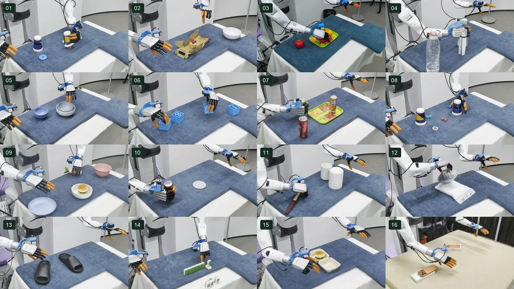</a>
</p>

**All 16 project-page tasks** are available below, in task order. Expand a group for complete **4× playback** GIF previews; each card links to the original-speed video. Tasks **01–15** form the paper's scored real-robot set. **Task 16 is supplementary** and excluded from the 15-task macro average.

<details>
<summary><strong>01–04 · Selection, Placement and Ordering</strong></summary>

<table>
  <tr><th>01 · Circle-Size Selection</th><th>02 · Unpack and Place Cake</th></tr>
  <tr>
    <td align="center"><a href="https://rapwam.github.io/assets/videos/stable-start/task-01.mp4">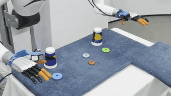</a><br><sub>Reasoning · <a href="https://rapwam.github.io/assets/videos/stable-start/task-01.mp4">Watch Original Video</a></sub></td>
    <td align="center"><a href="https://rapwam.github.io/assets/videos/stable-start/task-02.mp4">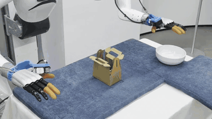</a><br><sub>Assembly · <a href="https://rapwam.github.io/assets/videos/stable-start/task-02.mp4">Watch Original Video</a></sub></td>
  </tr>
  <tr><th>03 · Fruit Placement</th><th>04 · Height-Based Bottle Ordering</th></tr>
  <tr>
    <td align="center"><a href="https://rapwam.github.io/assets/videos/task-03-trimmed.mp4">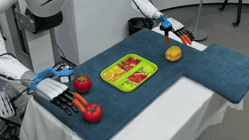</a><br><sub>Manipulation · <a href="https://rapwam.github.io/assets/videos/task-03-trimmed.mp4">Watch Original Video</a></sub></td>
    <td align="center"><a href="https://rapwam.github.io/assets/videos/stable-start/task-04.mp4">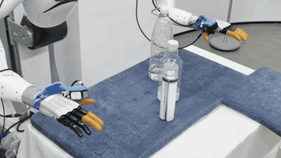</a><br><sub>Reasoning · <a href="https://rapwam.github.io/assets/videos/stable-start/task-04.mp4">Watch Original Video</a></sub></td>
  </tr>
</table>

</details>

<details>
<summary><strong>05–08 · Nesting, Rearrangement and Numerical Reasoning</strong></summary>

<table>
  <tr><th>05 · Bowl Nesting</th><th>06 · Numbered-Block Rearrangement</th></tr>
  <tr>
    <td align="center"><a href="https://rapwam.github.io/assets/videos/stable-start/task-05.mp4">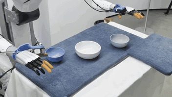</a><br><sub>Assembly · <a href="https://rapwam.github.io/assets/videos/stable-start/task-05.mp4">Watch Original Video</a></sub></td>
    <td align="center"><a href="https://rapwam.github.io/assets/videos/stable-start/task-06.mp4">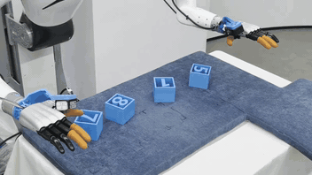</a><br><sub>Reasoning · <a href="https://rapwam.github.io/assets/videos/stable-start/task-06.mp4">Watch Original Video</a></sub></td>
  </tr>
  <tr><th>07 · Three-Can Tray Placement</th><th>08 · Numerical Extrema Selection</th></tr>
  <tr>
    <td align="center"><a href="https://rapwam.github.io/assets/videos/stable-start/task-07.mp4">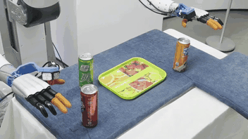</a><br><sub>Manipulation · <a href="https://rapwam.github.io/assets/videos/stable-start/task-07.mp4">Watch Original Video</a></sub></td>
    <td align="center"><a href="https://rapwam.github.io/assets/videos/stable-start/task-08.mp4">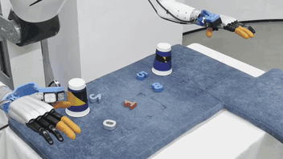</a><br><sub>Reasoning · <a href="https://rapwam.github.io/assets/videos/stable-start/task-08.mp4">Watch Original Video</a></sub></td>
  </tr>
</table>

</details>

<details>
<summary><strong>09–12 · Placement, Insertion and Organization</strong></summary>

<table>
  <tr><th>09 · Food Placement</th><th>10 · Can-on-Coaster Placement</th></tr>
  <tr>
    <td align="center"><a href="https://rapwam.github.io/assets/videos/stable-start/task-09.mp4">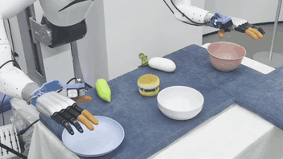</a><br><sub>Manipulation · <a href="https://rapwam.github.io/assets/videos/stable-start/task-09.mp4">Watch Original Video</a></sub></td>
    <td align="center"><a href="https://rapwam.github.io/assets/videos/stable-start/task-10.mp4">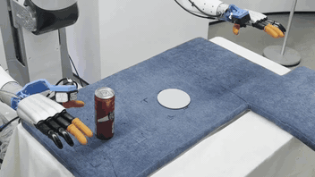</a><br><sub>Manipulation · <a href="https://rapwam.github.io/assets/videos/stable-start/task-10.mp4">Watch Original Video</a></sub></td>
  </tr>
  <tr><th>11 · Fan Insertion</th><th>12 · Towel Organization</th></tr>
  <tr>
    <td align="center"><a href="https://rapwam.github.io/assets/videos/stable-start/task-11.mp4">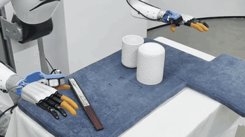</a><br><sub>Assembly · <a href="https://rapwam.github.io/assets/videos/stable-start/task-11.mp4">Watch Original Video</a></sub></td>
    <td align="center"><a href="https://rapwam.github.io/assets/videos/stable-start/task-12.mp4">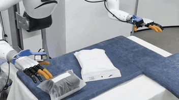</a><br><sub>Manipulation · <a href="https://rapwam.github.io/assets/videos/stable-start/task-12.mp4">Watch Original Video</a></sub></td>
  </tr>
</table>

</details>

<details>
<summary><strong>13–16 · Organization and Assembly</strong></summary>

<table>
  <tr><th>13 · Shoe Organization</th><th>14 · Mahjong Kong Formation</th></tr>
  <tr>
    <td align="center"><a href="https://rapwam.github.io/assets/videos/stable-start/task-13.mp4">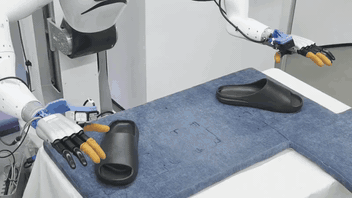</a><br><sub>Manipulation · <a href="https://rapwam.github.io/assets/videos/stable-start/task-13.mp4">Watch Original Video</a></sub></td>
    <td align="center"><a href="https://rapwam.github.io/assets/videos/stable-start/task-14.mp4">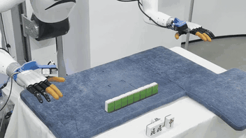</a><br><sub>Reasoning · <a href="https://rapwam.github.io/assets/videos/stable-start/task-14.mp4">Watch Original Video</a></sub></td>
  </tr>
  <tr><th>15 · Burger-Box Assembly</th><th>16 · Phone-Box Assembly</th></tr>
  <tr>
    <td align="center"><a href="https://rapwam.github.io/assets/videos/stable-start/task-15.mp4">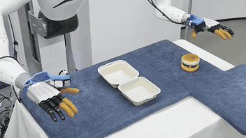</a><br><sub>Assembly · <a href="https://rapwam.github.io/assets/videos/stable-start/task-15.mp4">Watch Original Video</a></sub></td>
    <td align="center"><a href="https://rapwam.github.io/assets/videos/stable-start/task-16.mp4">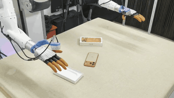</a><br><sub>Supplementary · Assembly · <a href="https://rapwam.github.io/assets/videos/stable-start/task-16.mp4">Watch Original Video</a></sub></td>
  </tr>
</table>

</details>

*Selected executions illustrate the research system, not success frequency or new results from this release. [Full video gallery and task-level results](https://rapwam.github.io/#demos).*

## Visualizations

### Predicted Futures

Recorded and predicted continuations at matched offsets from the **same training window**. These project-page frames are prediction diagnostics, separate from closed-loop robot evaluation.

<details>
<summary><strong>Real Robot · Phone Packing: Recorded vs. Predicted</strong></summary>

<table>
  <tr><th colspan="4">Real Robot · Phone Packing</th></tr>
  <tr><th>Continuation</th><th>t + 4</th><th>t + 8</th><th>t + 16</th></tr>
  <tr><th>Recorded</th><td>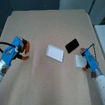</td><td>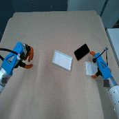</td><td>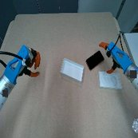</td></tr>
  <tr><th>Predicted</th><td>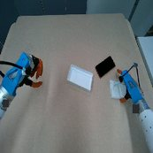</td><td>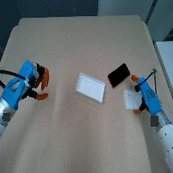</td><td>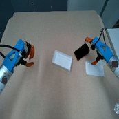</td></tr>
</table>

</details>

<details>
<summary><strong>RoboDojo · Arrange Numbers: Recorded vs. Predicted</strong></summary>

<table>
  <tr><th colspan="4">RoboDojo · Arrange Numbers</th></tr>
  <tr><th>Continuation</th><th>t + 4</th><th>t + 8</th><th>t + 16</th></tr>
  <tr><th>Recorded</th><td>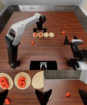</td><td></td><td></td></tr>
  <tr><th>Predicted</th><td></td><td>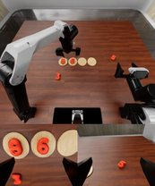</td><td></td></tr>
</table>

</details>

[Browse more tasks and offsets with the interactive comparison](https://rapwam.github.io/#predictions).

### Learning Signals

Inspect how rehearsal priors, prediction error and action response distribute supervision. The figures report fixed-policy diagnostics rather than component retraining or causal effects on robot success.

<details>
<summary><strong>Response Allocation and Temporal Credit</strong></summary>

Action perturbations reveal how video predictions respond to action inputs. The paper analyzes how this response complements current prediction error and the rehearsal prior when allocating visual and action supervision.

<p align="center">
  <a href="https://rapwam.github.io/#results">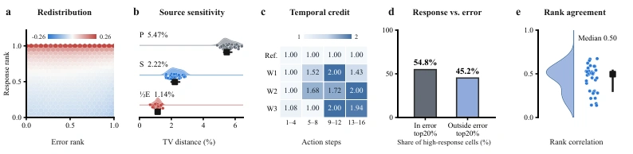</a>
</p>

*Fixed-policy supervision diagnostics from the paper: spatial redistribution, source sensitivity and temporal credit. These analyses do not retrain the policy or measure the causal effect of a component on robot success.*

</details>

<details>
<summary><strong>View prior evolution and credit dynamics</strong></summary>

<p align="center">
  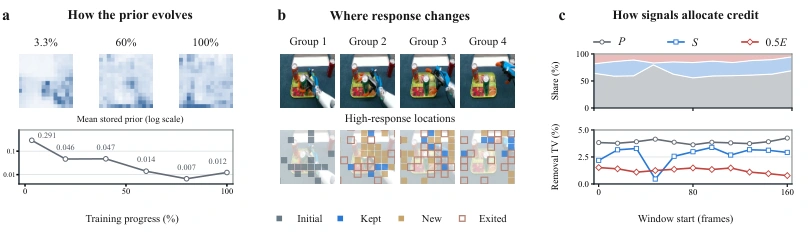
</p>

The left panel follows the stored spatial prior over training; the center shows changing response locations; the right compares signal allocation over task progress. See the paper appendices for the diagnostic sources and aggregation protocol.

</details>

## Documentation

| Goal | Guide |
|---|---|
| Set up the environment and assets | [Installation](docs/INSTALLATION.md) |
| Prepare demonstrations and train | [RoboDojo](docs/ROBODOJO.md) · [Real Robot](docs/REAL_ROBOT.md) · [Data Contracts](docs/DATA_FORMAT.md) |
| Adjust resources, losses or schedules | [Training Recipes](docs/TRAINING_RECIPES.md) · [Configuration](docs/CONFIGURATION.md) |
| Load checkpoints or diagnose a failure | [Checkpoints](docs/CHECKPOINTS.md) · [Troubleshooting](docs/TROUBLESHOOTING.md) |
| Understand the implementation and paper | [Architecture](docs/ARCHITECTURE.md) · [Paper Alignment](docs/PAPER_ALIGNMENT.md) · [Reproducibility](docs/REPRODUCIBILITY.md) |
| Review evidence and release history | [Validation Scope](docs/VALIDATION.md) · [Release Audit](docs/AUDIT_REPORT.md) · [Changelog](CHANGELOG.md) |

[Complete Documentation Index](docs/README.md) · [Contributing](CONTRIBUTING.md) · [Naming and Editorial Guide](docs/STYLE_GUIDE.md)

<details>
<summary><strong>Repository Structure</strong></summary>

```text
rap_wam/
├── README.md                  Project overview and first training commands
├── docs/                      Setup, method, data, recipes and troubleshooting
├── examples/                  Named-array export and run environment examples
├── rap_wam/
│   ├── configs/               RoboDojo / real_robot Hydra profiles
│   ├── policy/                Queries, CAP, rehearsal and response-credit policy
│   ├── data/                  Shared sequence and consecutive-chunk loaders
│   ├── core/                  Wan integration, normalization and training utilities
│   ├── prepare_data.py        LeRobot / NPZ → validated sharded Zarr
│   ├── task_context.py        Ordered instruction → UMT5 context table
│   ├── preflight.py           Data and training-asset checks
│   ├── launch.py              Portable torchrun launcher
│   └── workspace.py           CPU / DDP checkpoint workspace
├── scripts/                   Training entry scripts and documentation checks
├── tests/                     Synthetic-data, policy and training contracts
├── third_party/               Minimal Wan runtime and upstream license notices
├── provenance/                Source hashes and validation records
└── .github/                   CPU CI and contribution templates
```

</details>

<details>
<summary><strong>Development Checks and Validation Scope</strong></summary>

```bash
python scripts/check_docs.py
python -m rap_wam.check_release
python -m unittest discover -s tests -v
```

The 39-test runtime audit covers synthetic data, reduced-model gradients and checkpoint/trainer contracts. Separate evidence covers a fresh CPU installation, two-process CPU DDP and native CUDA projection heads. It does not establish full 5B convergence or robot task success. The documentation updates retain the 0.2.0 runtime evidence; see [Validation Scope](docs/VALIDATION.md).

</details>

## Citation

If RAP-WAM supports your research, please cite the paper. [CITATION.cff](CITATION.cff) supplies GitHub citation metadata; [citation.bib](citation.bib) contains the BibTeX entry.

```bibtex
@misc{he2026rapwam,
  title={RAP-WAM: Learning World-Action Models through Predictive Rehearsal and Action Perturbations},
  author={Yuanpeng He and Ceyao Zhang and Fangjing Li and Kefei Zhu and Lijian Li and Yueheng Li and Tianjia He and Wenpin Jiao and Zhi Jin and Yaodong Yang and Yuanpei Chen},
  year={2026},
  eprint={2610.16443},
  archivePrefix={arXiv},
  primaryClass={cs.AI},
  url={https://arxiv.org/abs/2610.16443}
}
```

## License and Acknowledgments

Project-specific code is released under [MIT](LICENSE). Vendored [Wan](https://github.com/Wan-Video/Wan2.2) components retain Apache-2.0; Diffusion Policy-derived utilities retain their upstream notices. See [THIRD_PARTY_NOTICES.md](THIRD_PARTY_NOTICES.md). Model weights and datasets have separate terms. Documentation figures and paired frames are attributed in [media notes](docs/media/README.md).
