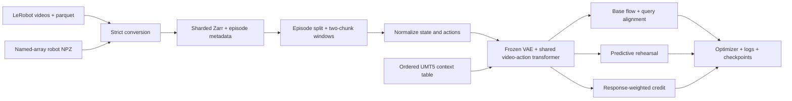

# Architecture and Code Navigation

[Documentation](README.md) / Architecture

RAP-WAM uses one shared video–action transformer initialized from Wan2.2-TI2V-5B video weights. Newly initialized action/state encoders, learned queries and CAP are trained on target demonstrations along with the trunk. There are no modality-specific transformer experts or extra task routers in the base learner.

## End-to-End Training Path



Language context is used only by RoboDojo. Rehearsal and credit use their own probability gates and warmup schedules. They augment ordinary base training rather than replace its recorded demonstration targets.

## Observation and Action Tensors

Batch dimensions below use B, input image height/width H/W, and action dimension D (14 or 28).

| Batch field | Shape | Role |
|---|---|---|
| `obs.rgb_head` | `[B,1,3,H,W]` | Current RGB condition, converted from uint8 to float image values |
| `obs.rgb_head_future` | `[B,16,3,H,W]` | Recorded first-chunk future |
| `obs.robot_state` | `[B,1,D]` | Current joint state |
| `action` | `[B,16,D]` | Recorded first-chunk absolute-joint actions |
| `obs2.rgb_head_future` | `[B,16,3,H,W]` | Recorded next-chunk future |
| `obs2.robot_state` | `[B,1,D]` | Recorded next-chunk initial state |
| `action_2` | `[B,16,D]` | Recorded next-chunk actions |
| `task_index` | `[B]`, RoboDojo only | Instruction/context row |

The VAE jointly encodes an observed prefix and 16 future RGB frames. With the model's temporal compression this produces one condition and four future latent time steps. Observation latents are clamped during denoising and excluded from future-only video loss. The normalized action chunk and video latents receive independent noise at a shared diffusion level; their regression target is noise minus clean input.

## Token Groups and Prediction Heads

A joint forward combines video V, action A, state S and learned query Q tokens. Video-only rotary position embeddings preserve the inherited video structure. Text cross-attention consumes the prepared context; predictive queries use action-side noise conditioning. The action-row/video-key attention block is suppressed, while action rows can read queries, actions and state. Indirect state-mediated visual paths remain; queries are not claimed to be the sole visual route.

Recorded future latents are pooled to 16 target positions and projected to 128D under stop-gradient. Query alignment updates the query side. CAP sums a compact MLP and a time-modulated sequence head into one action velocity. The compact MLP output projection starts at zero. Its `coarse_*` parameter names do not imply separate coarse/fine labels.

## Policy Implementation Chain

The inherited layers separate responsibilities within one policy:

```text
ImaginationQueryPolicy          Future-supervised query tokens and alignment
  └── DecoupledPolicy           Directional attention in training and sampling
      └── ResidualActionPolicy  Coupled Action Projection (CAP)
          └── CrossChunkPolicy  Sampled next-chunk rehearsal objective
              └── OnPolicyStatePolicy
                  └── DifficultyAdaptivePolicy
                      └── RAPPolicy
                          └── LanguageConditionedRAPPolicy
```

`OnPolicyStatePolicy` supplies the state-substitution schedule. `DifficultyAdaptivePolicy` implements the rehearsal body with optional local-batch difficulty correction. `RAPPolicy` captures the rehearsal-error prior and adds response-derived weighting. The language subclass selects context rows by task index. This chain is not an ensemble of separately deployed policies.

## Public Interfaces

| Entry / target | Purpose |
|---|---|
| `rap_wam.train` / `rap_wam_train` | Resolve a Hydra profile, validate assets and run training |
| `rap_wam.prepare_data` / `rap_wam_prepare` | Convert LeRobot or NPZ episodes |
| `rap_wam.preflight` / `rap_wam_preflight` | Standalone dataset validation |
| `rap_wam.task_context` / `rap_wam_task_context` | Build the ordered language table |
| `rap_wam.launch` | Construct portable torchrun arguments and batch accounting |
| `rap_wam.workspace.TrainWorkspace` | CPU/DDP training and checkpoint workspace |
| `rap_wam.datasets.RoboDojoDataset` | Strict language-labelled 14D adapter |
| `rap_wam.datasets.RealRobotDataset` | Strict fixed100 28D adapter |
| `rap_wam.policy.rap_policy.RAPPolicy` | Real-robot policy target |
| `rap_wam.policy.language_policy.LanguageConditionedRAPPolicy` | RoboDojo policy target |

## Package Responsibilities

```text
rap_wam/
  configs/       Shared defaults and the two public Hydra recipes
  policy/        Future queries, attention, CAP, rehearsal and credit
  data/          Shared sequence/two-chunk and language dataset implementations
  core/          Tensor utilities, normalizers, Wan integration and base workspace
  training/      Optional visual-metric workspace layer
  datasets.py    Strict public data-adapter constraints
  workspace.py   Ordinary CPU/DDP checkpoint specialization
```

The minimal Wan runtime is vendored under `third_party/wan_official`. This release resolves that runtime within the source/installed package; a private server checkout is unnecessary. Dataset/model weights remain external.

Public module targets are the supported API. Tensor parameter names are retained; earlier serialized configurations with different module paths require explicit migration. [PAPER_ALIGNMENT.md](PAPER_ALIGNMENT.md) maps equations/configuration names and documents the public auxiliary-failure behavior. [DATA_FORMAT.md](DATA_FORMAT.md) defines raw data and temporal offsets, while [CHECKPOINTS.md](CHECKPOINTS.md) explains persisted state.
